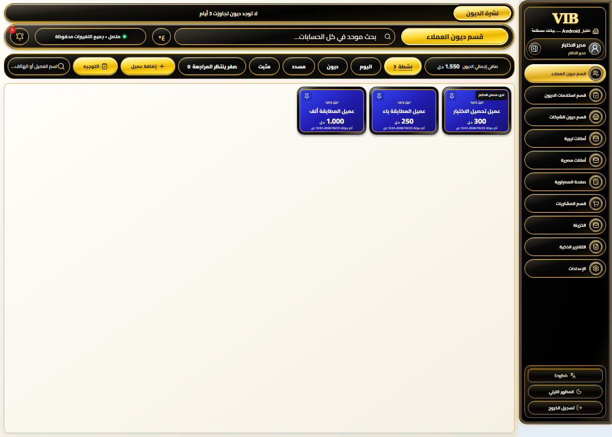
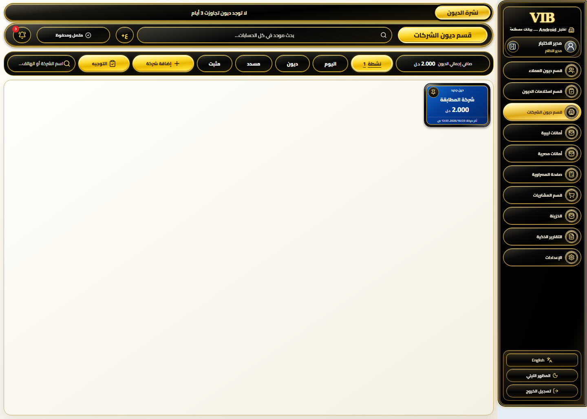
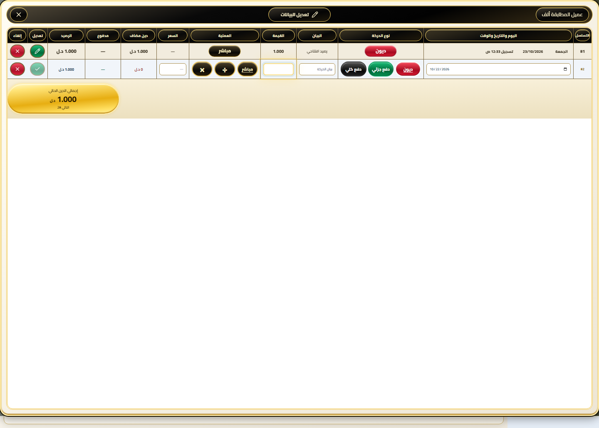
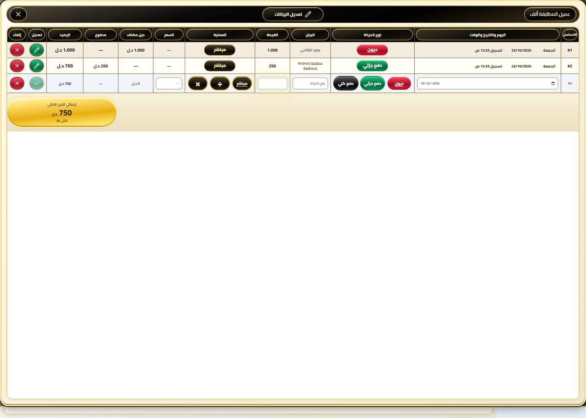
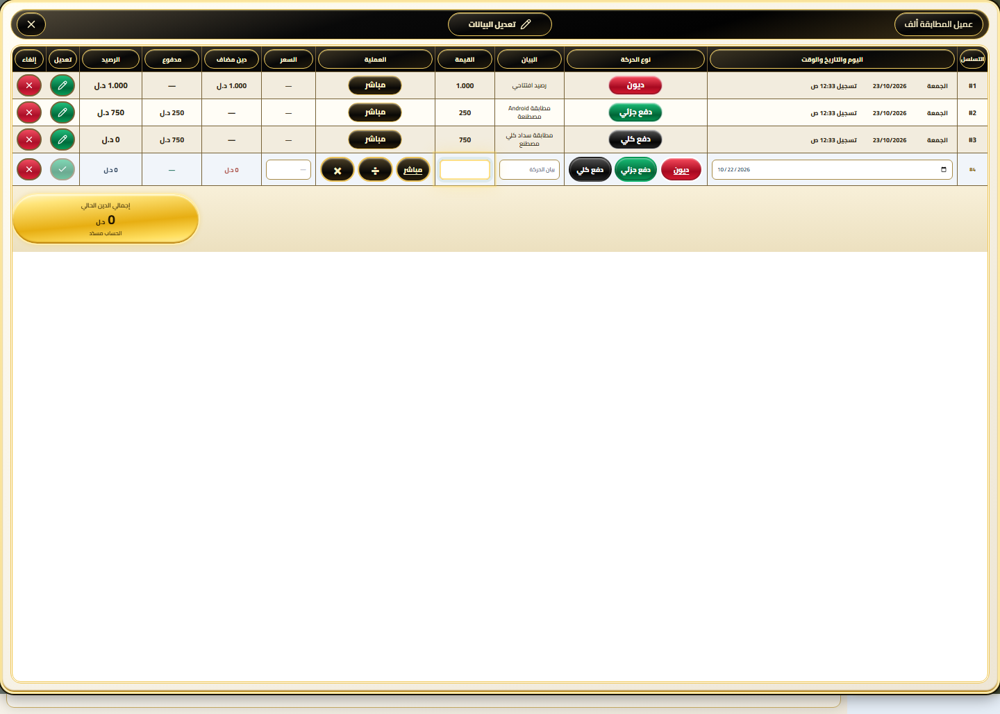
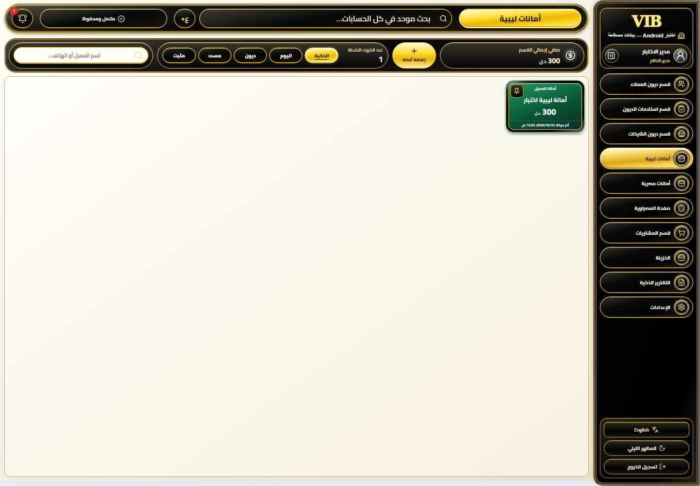
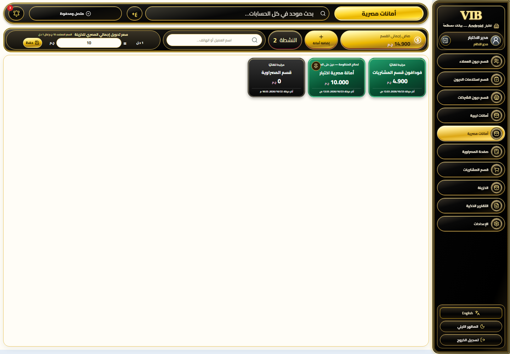
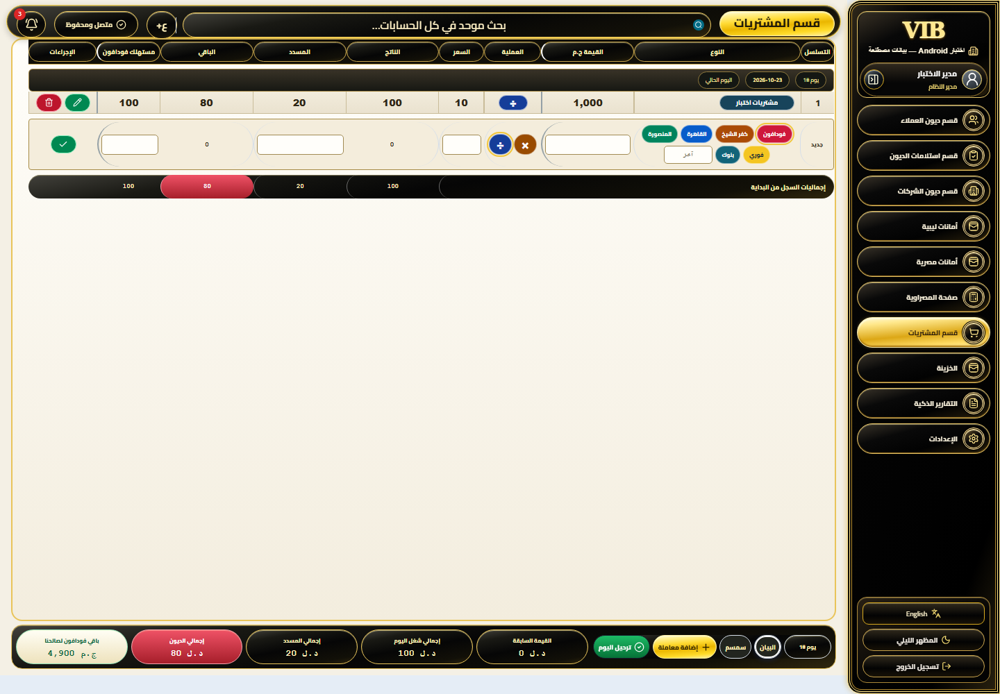
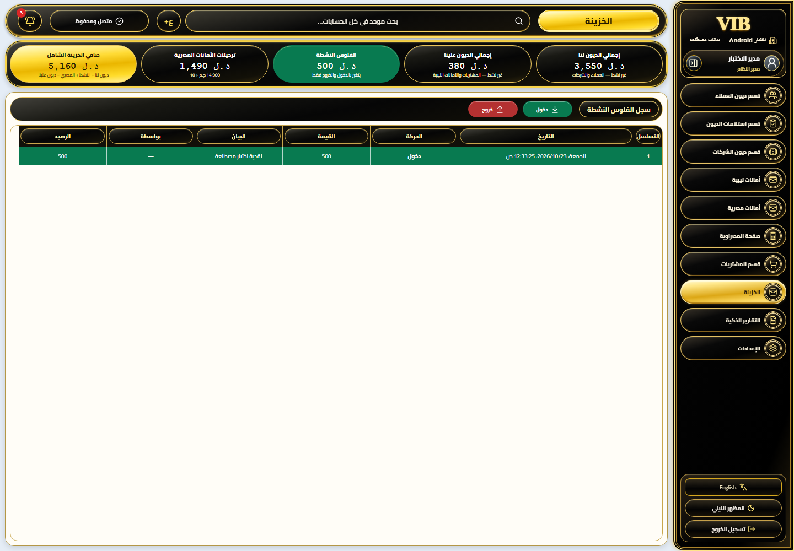
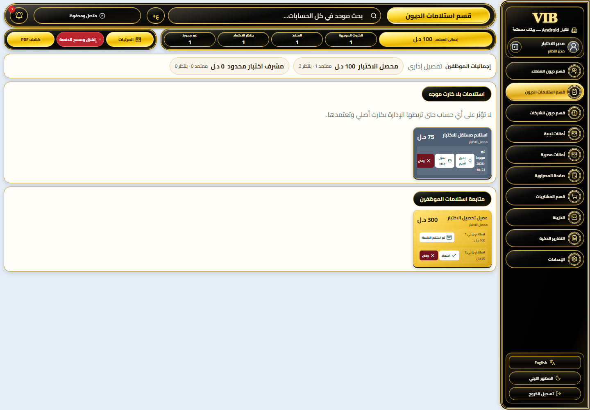

# جدول مطابقة الموقع مع API — بيانات مصطنعة

تاريخ ليبيا:23 أكتوبر2026. commit:537f073e8fc76ec2ee9120a198272413d5ea68d9. عميل المطابقة ألف:`0850d816-6dc0-4d85-b46f-fb0a6ef1cb11`.

القيم العامة لمرحلة البداية قبل دفع250 ثم750، وليست قيم الإنتاج. رصيد العميل الحالي في sandbox صفر بعد الاختبار. للمقارنة من البداية أنشئ sandbox جديدًا، ثم نفذ السيناريو. عمود Flutter متروك للفريق؛ لا ندعي اختباره.

| البند | الموقع وAPI | العملة | المفتاح | Flutter | الصورة |
|---|---:|---|---|---|---|
| إجمالي ديون العملاء | 1550 | LYD | customers.summary.totalDebt | لم يُختبر | [صورة](01-customer-total.png) |
| إجمالي ديون الشركات | 2000 | LYD | companies.summary.totalDebt | لم يُختبر | [صورة](02-company-total.png) |
| عميل المطابقة ألف قبل الدفع | 1000 | LYD | ledger.customer.balanceUnits | لم يُختبر | [صورة](03-customer-initial.png) |
| بعد دفع جزئي250 | 750 | LYD | ledger.customer.balanceUnits | لم يُختبر | [صورة](04-customer-after-partial.png) |
| بعد سداد الباقي750 | 0 | LYD | ledger.customer.balanceUnits | لم يُختبر | [صورة](05-customer-after-full.png) |
| صافي الأمانات الليبية | 300 | LYD | summary.netBalance | لم يُختبر | [صورة](06-libyan-deposits.png) |
| صافي الأمانات المصرية شاملاً فودافون | 14900 | EGP | summary.netBalance | لم يُختبر | [صورة](07-egyptian-deposits.png) |
| رصيد المشتريات — البيان | 80 | LYD | registerTotals.remainingUnits | لم يُختبر | [صورة](08-purchases.png) |
| الخزينة — صافي شامل | 5160 | LYD | netUnits | لم يُختبر | [صورة](09-treasury.png) |
| الخزينة — نقدية نشطة | 500 | LYD | activeCashUnits | لم يُختبر | [صورة](09-treasury.png) |
| الاستلامات المعتمدة | 100 | LYD | metrics.collectedUnits | لم يُختبر | [صورة](10-collections.png) |

## لقطات الموقع

### إجمالي ديون العملاء

### إجمالي ديون الشركات

### عميل المطابقة ألف قبل الدفع

### بعد دفع جزئي250

### بعد سداد الباقي750

### صافي الأمانات الليبية

### صافي الأمانات المصرية شاملاً فودافون

### رصيد المشتريات — البيان

### الخزينة — صافي شامل

### الاستلامات المعتمدة

